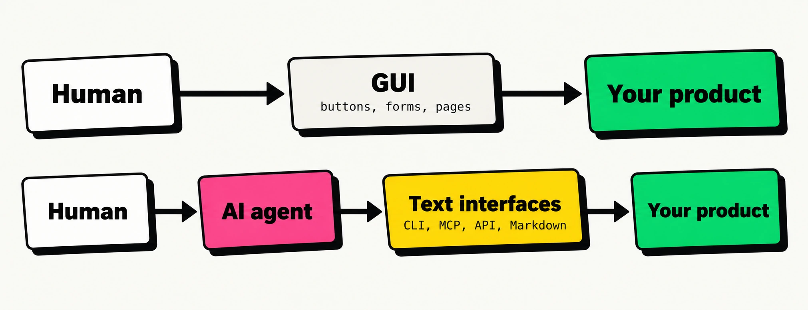
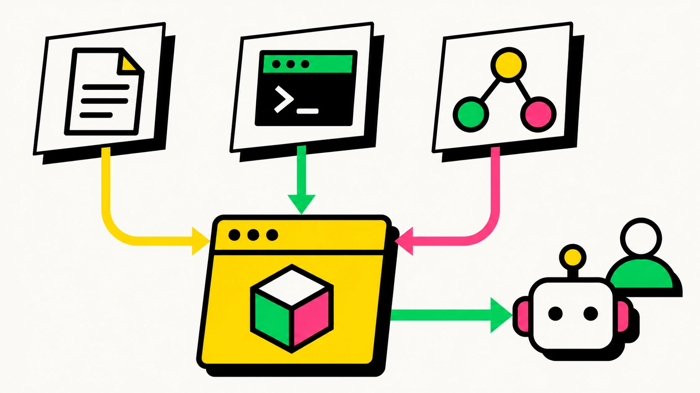
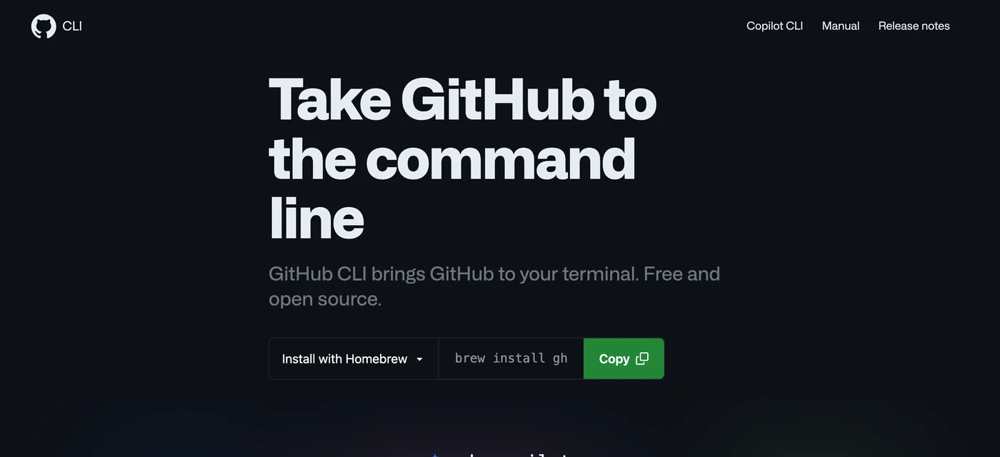
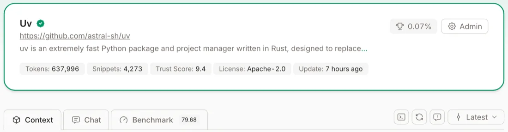
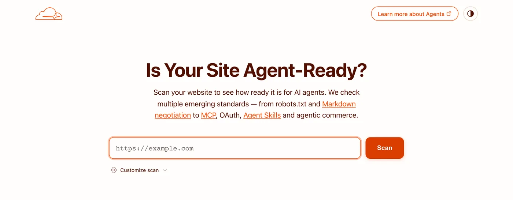
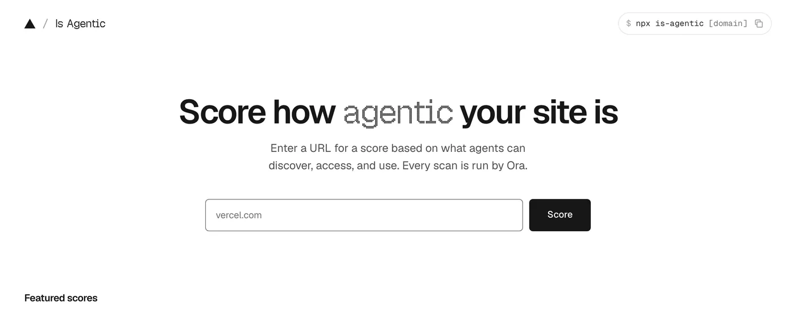
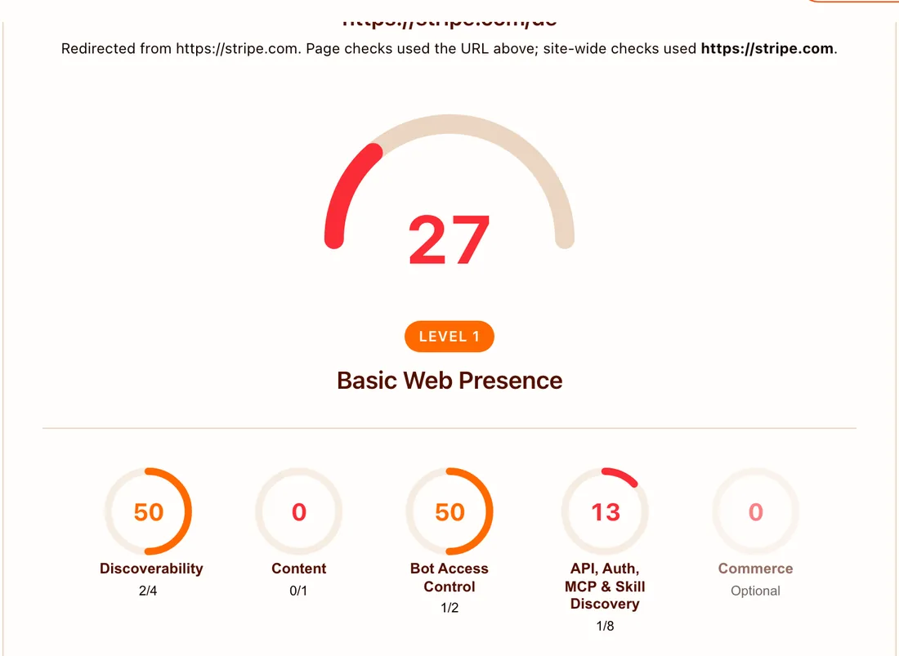
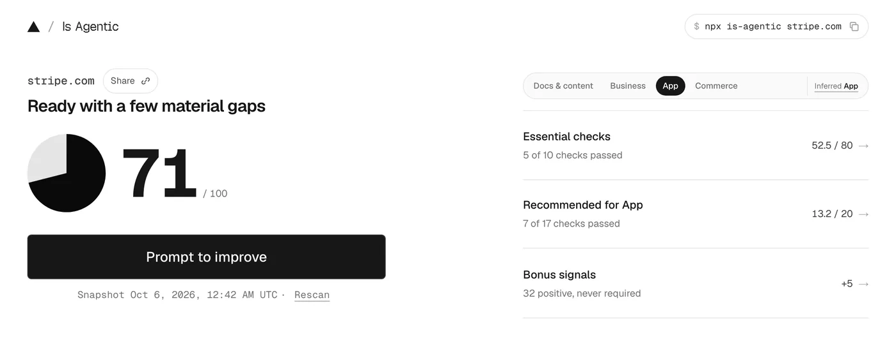
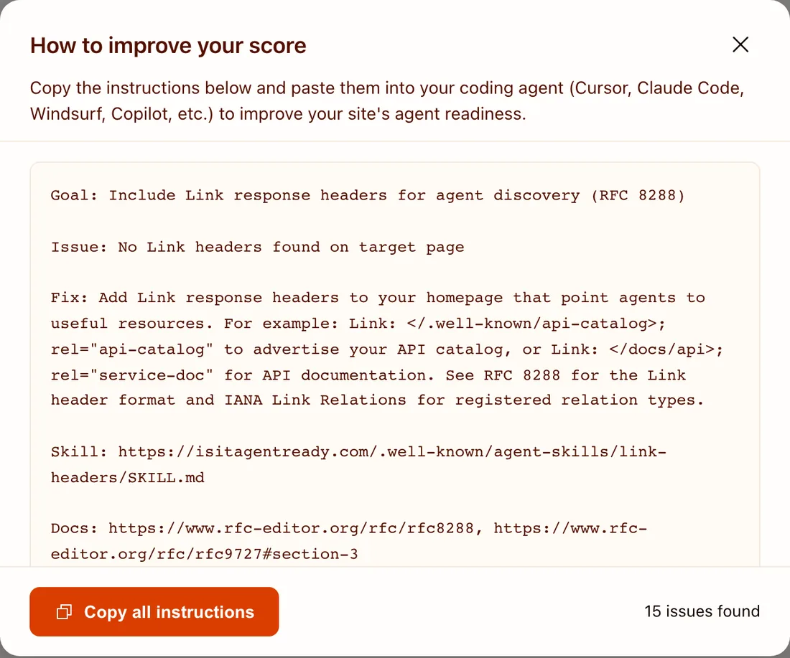
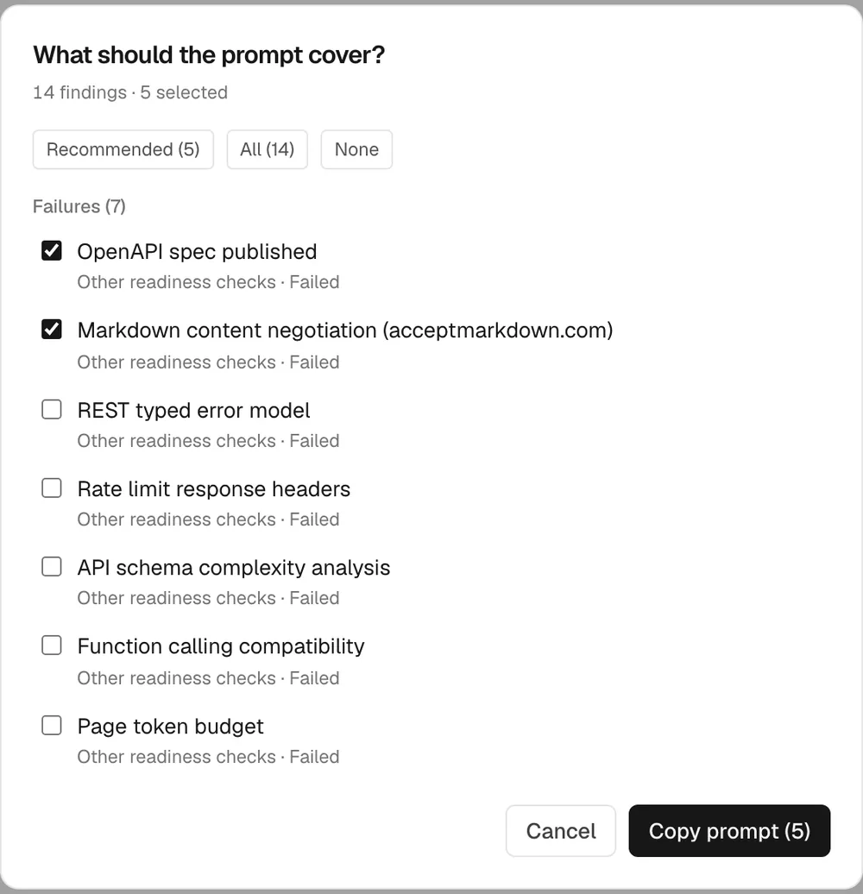

---
format:
  revealjs:
    css: style.css
    theme: simple
    revealjs-plugins:
      - a11y
      - read-aloud
    revealjs-a11y:
      # The extension's menus introduce ARIA failures; retain our slide-menu handling.
      slide-menu-a11y: false
      menu: false
      # Use the extension's core accessibility fixes without extra UI/shortcuts.
      font-size-controls: false
      font-selection: false
      text-spacing: false
      transcript: false
      slide-change-cue: false
    slide-number: true
    code-line-numbers: false
    highlight-style: github
    preview-links: auto
    keyboard: true
    touch: true
    help: true
    include-in-header: meta-tags.html
    include-after-body: accessibility.html
    link-external-newwindow: true
    mermaid:
      theme: neutral
execute:
  echo: true
  eval: false
keywords: ["ai-agents", "agentic-web", "mcp", "cli", "agent-skills", "package-documentation", "context7", "llms-txt", "webmcp", "software-engineering"]
description-meta: "How to help AI agents operate software, use package skills and docs, and navigate and trust websites through CLIs, MCP servers, and the agentic web."
license: "CC0 1.0 Universal"
pagetitle: "Building Software Products for the Agentic Age"
author-meta: "Indrajeet Patil"
date-meta: "2026-10-07"
lang: "en"
dir: "ltr"
image: "media/social-media-card.webp"
image-alt: "Title slide of a presentation about building software products for the agentic age"
canonical-url: "https://www.indrapatil.com/software-for-agentic-age/"
jupyter: python3
---

## Building Software Products for the Agentic Age {.hero .center background-color="#FFD600"}

::: {.tag}
CLI · MCP · Agentic web
:::

::: {.hero-sub}
Your next user <span class="sticker">reads text</span>, <span class="sticker amber">calls tools</span>, and <span class="sticker pink">clicks as a last resort</span>.
:::

::: {.hero-author}
Indrajeet Patil
:::

::: {.hero-source}
Source code for these slides can be found [on GitHub](https://github.com/IndrajeetPatil/software-for-agentic-age/).
:::

::: {.notes}
Welcome. This talk is about building software products and websites that AI agents can use on people's behalf. These users work through text, tools, and repeated actions. We will look at what helps them find information, operate a product, and understand the result.
:::

## The agentic age has already arrived

::: {.grid-3}

::: {.card .pink .stat .tilt-l}
<span class="num">&lt; 50%</span>
<span class="label">of HTML page requests on Cloudflare come from a human</span>
:::

::: {.card .amber .stat .tilt-r}
<span class="num">&gt; 1,700%</span>
<span class="label">growth in daily AI agent requests on Cloudflare in one year</span>
:::

::: {.card .yellow .stat .tilt-l}
<span class="num">2 : 1</span>
<span class="label">agent requests to human page loads on Mintlify-hosted docs</span>
:::

:::

::: {.source}
Sources: Cloudflare, [From ranking to recommended](https://blog.cloudflare.com/aeo/) (Aug 2026) and [The Internet has a second audience](https://blog.cloudflare.com/agentic-web/) (Sep 2026); Mintlify, [State of Knowledge 2026](https://www.mintlify.com/blog/the-state-of-knowledge-2026-highlights) (Aug 2026: 257M agent requests, 131M human page loads)
:::

::: {.fragment}
### Most of the web isn't there yet

Adoption among [Cloudflare Radar](https://radar.cloudflare.com/)'s top 200,000 domains, Apr 2026:

```{=html}
<div class="bars" role="img" aria-label="Bar chart: robots.txt present on 78% of sites, Content Signals on 4%, Markdown negotiation on 3.9%, MCP Server Cards on fewer than 15 sites">
  <span><code>robots.txt</code> present</span><span class="track"><span class="fill" style="width: 78%;"></span></span><span class="val">78%</span>
  <span>Content Signals</span><span class="track"><span class="fill" style="width: 4%;"></span></span><span class="val">4%</span>
  <span>Markdown negotiation</span><span class="track"><span class="fill" style="width: 3.9%;"></span></span><span class="val">3.9%</span>
  <span>MCP Server Card</span><span class="track"><span class="fill" style="width: 0%;"></span></span><span class="val">&lt;15 sites</span>
</div>
```

::: {.source}
Source: Cloudflare, [Introducing the Agent Readiness score](https://blog.cloudflare.com/agent-readiness/)
:::
:::

::: {.notes}
Why should this matter to you now? Because the shift has already happened. Cloudflare, which sits in front of roughly a fifth of the web, reports that fewer than half of the HTML page requests it sees now come from a human. Over the past year, daily requests from AI agents on its network grew by more than seventeen hundred per cent. Developer documentation shows the same pattern: on sites hosted by Mintlify, agents made about twice as many requests as people made page loads in August 2026. These measures count requests rather than people, so they are not like-for-like, but the direction is clear. But are our products ready for them? Cloudflare scanned the top two hundred thousand domains on its Radar ranking to find out. Most sites publish a robots file, a convention that dates back to the nineties. Very few go further. Only about four per cent declare how their content may be used by AI, fewer than four per cent can serve a clean Markdown version of a page to an agent, and fewer than fifteen sites advertise an MCP server that agents can discover. Demand from agents has grown quickly, but most products are still built only for people with browsers.
:::

## What you'll learn today

::: {.grid-2}

::: {.card .cream}
::: {.card-title}
📋 We assume you know
:::

- what a large language model (LLM) is
- an **agent** is an LLM calling tools in a loop
- CLI, HTTP, and HTML basics
:::

::: {.card .yellow .tilt-r}
::: {.card-title}
🎯 You will leave with
:::

- how agents *experience* products
- products agents **act** on
- software packages agents can **learn and retrieve docs for**
- websites agents **read** and cite
- tools to measure readiness
:::

:::

::: {.callout-big}
Agent-friendliness is a new layer **on top of** good engineering, not a replacement for it.
:::

::: {.notes}
We will cover four areas: interfaces agents can operate, software packages they can learn to use, websites they can read and assess, and ways to measure readiness and catch regressions as products change.
:::

# A new kind of user {background-color="#FFD600"}

::: {.tag}
Part 0 · Foundations
:::

::: {.notes}
Software agents are a new kind of user. They act on behalf of people, but they interact with products differently from someone clicking through a graphical interface.
:::

## Same product, new user

For decades, every user reached your product (libraries, services, websites, etc.) through a **screen**. Now many arrive through an **agent**.

{width="900" height="346" fig-alt="Two paths into the same product: a human uses GUI buttons, forms, and pages; another human delegates to an AI agent that uses text interfaces such as CLI, MCP, API, and Markdown."}

::: {.callout-big}
Agents *can* see and click, but don't **require** it. Offer **text interfaces** and a **path for human approval**.
:::

::: {.notes}
The product still serves a person's needs. An agent changes the route to that product: it needs clear context, predictable results, and an interface it can operate. Visual polish matters to human users, while a text-based agent needs the underlying information and actions to be accessible without it.
:::

## Humans and agents need different things

| Need | Human user | Agent user |
|------|------------|------------|
| **Input** | Pixels on a screen | Text in a context window |
| **Navigation** | Menus, clicks, scrolling | Commands, links, tool calls |
| **Learning** | Tutorials, tooltips | `--help`, schemas, `llms.txt` |
| **Errors** | Red banner, retry button | Exit code + message it can act on |
| **Login** | Form, password, MFA prompt | Token, OAuth flow, environment variable |
| **Noise** | Mildly annoying | Costs tokens and derails the task |

::: {.callout-big}
Good news: most of what agents need is **what good engineering already recommends**.
:::

::: {.notes}
People benefit from visual cues, progressive disclosure, and forgiving interfaces. Agents need structured inputs, explicit errors, and concise results. Supporting both means choosing suitable interfaces for each, while keeping the underlying product behaviour consistent.
:::

# Products agents can operate {background-color="#FFD600"}

::: {.tag}
Part 1 · CLI and MCP
:::

::: {.notes}
Let’s start with products agents can operate: the interfaces through which they discover capabilities and perform useful work.
:::

## Three ways in

:::: {.entry-figure}

{width="640" height="360" fig-alt="Three distinct interfaces—an HTTP API, a command-line terminal, and an MCP server—feed a shared software product, which an AI agent uses on a person's behalf."}

::: {.grid-3 .entry-labels}

::: {.entry-label}
<span class="tag yellow">HTTP API</span>
:::

::: {.entry-label}
<span class="tag green">CLI</span>
:::

::: {.entry-label}
<span class="tag pink">MCP server</span>
:::

:::

::::

::: {.callout-big}
Build a good API. Add a CLI or MCP where they fit.
:::

::: {.source}
Hosts can defer MCP tool schemas and load them on demand: see Anthropic's [tool search tool](https://platform.claude.com/docs/en/agents-and-tools/tool-use/tool-search-tool).
:::

::: {.notes}
There are three common entry points: an HTTP API, a command-line interface, and a Model Context Protocol server. Build the product capability once, then expose the interfaces that fit your users' agents.
:::

## A minimal agent-friendly CLI

::: {.panel-tabset}

### todo.py

A toy `todo` CLI in [Typer](https://typer.tiangolo.com/). Highlights mark the agent-friendly bits.

::: {.code-sm}

```{.python code-line-numbers="4,8,13,16-17,19-20"}
from json import dumps
import typer

app = typer.Typer(rich_markup_mode=None)  # plain text: no box art for agents
TODOS = [{"id": 1, "title": "Write slides"}]

@app.command("list")
def list_todos(json: bool = typer.Option(False, "--json")):
    """Show all todos."""
    print(dumps(TODOS) if json else "\n".join(t["title"] for t in TODOS))

@app.command()
def delete(todo_id: int, yes: bool = typer.Option(False, "--yes")):
    """Delete a todo by id."""
    if todo_id not in {t["id"] for t in TODOS}:
        typer.echo(f"error: no todo {todo_id}; run `todo list`", err=True)
        raise typer.Exit(3)
    if not yes:
        typer.echo("error: deleting needs --yes", err=True)
        raise typer.Exit(4)
    print(dumps({"deleted": todo_id}))

app()
```

:::

::: {.source}
A stub: `delete` validates and reports but stores nothing. Typer turns type hints and docstrings into `--help`. Exit code `2` already means a usage error, so domain errors start at `3`. Tested with [Typer](https://typer.tiangolo.com/) 0.29.2.
:::

### Anatomy

| Principle | Why agents care | Looks like |
|-----------|-----------------|------------|
| **Structured output** | Parse, don't scrape tables | `--json`, `-o json` |
| **Field selection** | Smaller output, fewer tokens | `--json name,id`, `--query` |
| **Never block on input** | No one is there to type `y` | `--yes`, `GH_PROMPT_DISABLED=1` |
| **Headless auth** | Agents can't click "Sign in" | `GH_TOKEN=…`, `az login --identity` (on Azure) |
| **Meaningful exit codes** | Branch on success vs failure | `0` ok, `2` bad usage, `3` not found, `4` refused |
| **Actionable errors on stderr** | Self-correct on the next turn | `error: no todo 7; run todo list` |
| **Examples in `--help`** | Learn usage on demand | `gh pr create --help` |
| **Stable, versioned output** | Scripts and agents break silently | Add fields; never rename them |

: {tbl-colwidths="[24,30,46]"}

::: {.source}
Sources: [Arcjet](https://blog.arcjet.com/designing-a-cli-for-ai-agents/), [Speakeasy](https://www.speakeasy.com/blog/engineering-agent-friendly-cli), [GitHub CLI manual](https://cli.github.com/manual/gh_help_environment)
:::

:::

::: {.notes}
The Python example uses Typer to expose a small command. Its JSON option returns structured data, its confirmation option supports non-interactive use, and its errors go to the error stream. The Anatomy tab summarises the underlying conventions: structured output, non-interactive operation, headless authentication, and actionable error messages.
:::

## The same CLI, seen by an agent

:::: {.columns}

::: {.column width="50%"}

::: {.tag .blue}
Human mode
:::

```{.bash filename="terminal"}
$ todo list
Write slides
```

::: {.tag .green}
Agent mode
:::

```{.bash filename="terminal"}
$ todo list --json
[{"id": 1, "title": "Write slides"}]
```

:::

::: {.column width="50%"}

::: {.tag .red}
Failures that teach the agent
:::

```{.bash filename="terminal"}
$ todo delete 7
error: no todo 7; run `todo list`

$ todo delete 1
error: deleting needs --yes

$ todo delete 1 --yes
{"deleted": 1}
```

:::

::::

::: {.callout-big}
Each error tells the agent **what went wrong** and **what to try next**.
:::

::: {.notes}
A formatted table is convenient for a person scanning a terminal. JSON is convenient for a program selecting fields and deciding its next action. Offering both avoids asking the agent to reconstruct structured data from colours, columns, and progress messages.
:::

## Exemplar: GitHub CLI (`gh`)

:::: {.columns}

::: {.column width="45%"}

{.shot width="280" height="128" fig-alt="Screenshot of the GitHub CLI home page with the headline Take GitHub to the command line"}

::: {.card .green .tilt-l}
- `--json` + `--jq` almost everywhere
- `GH_TOKEN` for headless auth
- `GH_PROMPT_DISABLED` stops prompts
:::

:::

::: {.column width="55%"}

::: {.code-sm}

```{.bash filename="terminal"}
# Ask for exactly the fields you need
$ gh pr list --repo cli/cli --limit 3 \
    --json number,author \
    --jq '.[] | "\(.number) \(.author.login)"'
14620 williammartin
14617 bingtang9
14583 BagToad

# Escape hatch: any REST endpoint, authenticated
$ gh api repos/cli/cli --jq '.license.spdx_id'
MIT
```

:::

:::

::::

::: {.callout-big}
Pattern: **human-friendly by default, machine-friendly by flag**, with the full API one command away.
:::

::: {.source}
Sources: [GitHub CLI homepage](https://cli.github.com/) and [GitHub CLI manual](https://cli.github.com/manual/)
:::

::: {.notes}
The GitHub CLI combines ordinary commands with an authenticated API escape hatch. Its JSON output and query filtering let an agent request only the fields it needs. Disabling interactive prompts also lets an automated task fail clearly instead of waiting for input that will never arrive.
:::

## What is MCP?

The **Model Context Protocol** is an open standard for plugging tools and data into any agent host. Current spec: <span class="sticker yellow">2026-07-28</span>

```{mermaid}
%%| eval: true
%%| echo: false
%%{init: {"htmlLabels": false, "flowchart": {"htmlLabels": false, "padding": 16}, "themeVariables": {"fontFamily": "Space Grotesk, sans-serif", "fontSize": "20px"}}}%%
flowchart LR
    subgraph Host["Agent host"]
        M[LLM] <--> C[MCP client]
    end
    C <-- "server/discover<br/>tools/list<br/>tools/call" --> S[Your MCP server]
    S <--> API[Your API]

    classDef box fill:#ffffff,stroke:#0a0a0a,stroke-width:3px,color:#0a0a0a
    classDef yours fill:#ffd600,stroke:#0a0a0a,stroke-width:3px,color:#0a0a0a
    class M,C box
    class S,API yours
    style Host fill:#f5f5f0,stroke:#0a0a0a,stroke-width:3px,color:#0a0a0a
```

::: {.grid-3}

::: {.card .yellow}
**Tools**: actions the model can call
:::

::: {.card .green}
**Resources**: data the app can read
:::

::: {.card .pink}
**Prompts**: templates the user can pick
:::

:::

::: {.source}
Source: [MCP specification 2026-07-28](https://modelcontextprotocol.io/specification/2026-07-28)
:::

::: {.notes}
MCP stands for Model Context Protocol. It is an open specification for connecting AI applications to tools, resources, and prompt templates. It gives different hosts a common way to discover and invoke capabilities.
:::

## A minimal MCP server

:::: {.columns}

::: {.column width="52%"}

::: {.code-sm}

```{.python filename="server.py: you write"}
from mcp.server import MCPServer

mcp = MCPServer("Todo")


@mcp.tool()
def add_todo(
    title: str, due: str | None = None
) -> dict:
    """Create a todo. due: ISO date."""
    return {"id": 42, "title": title}


if __name__ == "__main__":
    mcp.run("streamable-http")
```

:::

:::

::: {.column width="48%"}

::: {.code-sm}

```{.json filename="tools/list: the agent sees"}
{
  "name": "add_todo",
  "description": "Create a todo. due: ISO date.",
  "inputSchema": {
    "type": "object",
    "properties": {
      "title": {"type": "string"},
      "due": {"anyOf": [{"type": "string"},
                        {"type": "null"}]}
    },
    "required": ["title"]
  }
}
```

:::

:::

::::

::: {.callout-big}
Type hints and docstrings **become the interface**. Write them for a reader with no context.
:::

::: {.source}
A stub: `add_todo` stores nothing and ignores `due`. Tested with the [MCP Python SDK](https://py.sdk.modelcontextprotocol.io/v2/) 2.3.0, which speaks protocol 2026-07-28; schema output abridged.
:::

::: {.notes}
The MCP server example derives a tool's interface from Python type hints and a docstring. The description matters as much as the argument types: it helps the model decide whether this tool fits the current task and how to use it correctly.
:::

## Every request stands alone

:::: {.columns}

::: {.column width="58%"}

::: {.code-sm}

```{.default filename="POST /mcp: headers"}
Content-Type: application/json
Accept: application/json, text/event-stream
MCP-Protocol-Version: 2026-07-28
Mcp-Method: tools/call
Mcp-Name: add_todo
```

```{.json filename="POST /mcp: body"}
{
  "jsonrpc": "2.0",
  "id": 1,
  "method": "tools/call",
  "params": {
    "name": "add_todo",
    "arguments": {"title": "Write slides"},
    "_meta": {
      "io.modelcontextprotocol/protocolVersion":
        "2026-07-28",
      "io.modelcontextprotocol/clientCapabilities":
        {}
    }
  }
}
```

:::

:::

::: {.column width="42%"}

::: {.code-sm}

```{.json filename="200 OK: the result"}
{
  "jsonrpc": "2.0",
  "id": 1,
  "result": {
    "resultType": "complete",
    "content": [{
      "type": "text",
      "text": "{\"id\": 42, ...}"
    }],
    "isError": false
  }
}
```

:::

::: {.card .yellow style="font-size: 0.7em;"}
No sessions, so **any replica can take the request**. Cache discovery and reads by their hints; keep app state in a shared store.
:::

:::

::::

::: {.source}
Sent with [curl](https://curl.se/) to the minimal `server.py` from the previous slide ([MCP Python SDK](https://py.sdk.modelcontextprotocol.io/v2/) 2.3.0); without the headers the server returns `400`. Response abridged. Specs: [Streamable HTTP](https://modelcontextprotocol.io/specification/2026-07-28/basic/transports/streamable-http), [caching](https://modelcontextprotocol.io/specification/2026-07-28/server/utilities/caching).
:::

::: {.notes}
In the specification version used by this presentation, each request carries its own protocol and capability information. The server does not need a long-lived session to interpret it. That makes requests easier to route between replicas behind a load balancer.
:::

## CLI or MCP?

::: {.grid-2}

::: {.card .yellow .tilt-l}
::: {.card-title}
Prefer a CLI when
:::

- the agent has a terminal (coding agents)
- one developer, their own credentials
- output needs piping and scripting
- humans use the same tool
:::

::: {.card .green .tilt-r}
::: {.card-title}
Prefer MCP when
:::

- the agent has no shell (chat apps)
- many users need per-user OAuth
- you need central governance and audit
- you want hosted, zero-install access
:::

:::

::: {.notes}
A CLI fits agents that already have shell access and developer credentials. MCP fits hosts that need a governed tool connection, such as a web assistant or an enterprise application. The right choice depends on where the agent runs and how access is controlled.
:::

## Control delegated access

::: {.grid-2 .security-grid}

::: {.card .yellow}
::: {.card-title}
🔑 Least privilege
:::
Use scoped, short-lived, read-only tokens by default.
:::

::: {.card .amber}
::: {.card-title}
🧪 Dry runs, safe retries
:::
Dry-run writes; use idempotency keys for safe retries.
:::

::: {.card .pink}
::: {.card-title}
🛑 Explicit intent
:::
Require explicit consent for destructive actions.
:::

::: {.card .green}
::: {.card-title}
🧾 Audit trail
:::
Identify agent traffic and log consequential actions.
:::

:::

::: {.callout-big .callout-compact}
Treat tool output as **untrusted input**.
:::

::: {.source}
Sources: [MCP tools: user interaction](https://modelcontextprotocol.io/specification/2026-07-28/server/tools), [Stripe idempotent requests](https://docs.stripe.com/api/idempotent_requests)
:::

::: {.notes}
CLI and MCP determine how an agent reaches product capabilities. Keep the access it receives narrow, make consequential writes safe to retry, ask for explicit intent before destructive actions, and record what happened. Treat text returned by tools as untrusted input because it can contain instructions aimed at the agent.
:::

## Design beats protocol

A naive MCP server exposes one tool per endpoint. Cloudflare's API has **2,500+** endpoints.

::: {.grid-2}

::: {.card .red .stat}
<span class="num">~1.17M</span>
<span class="label">tokens of tool definitions: one tool per endpoint</span>
:::

::: {.card .green .stat}
<span class="num">~1,000</span>
<span class="label">tokens of tool definitions: search() + execute()</span>
:::

:::

::: {.callout-big}
Expose **discoverable, task-shaped tools**, not raw endpoints. Let the agent search for detail on demand.
:::

::: {.source}
The numbers compare what the tool definitions cost in context, not total task tokens, latency, or success rate. Source: Cloudflare, [Code Mode: give agents an entire API in 1,000 tokens](https://blog.cloudflare.com/code-mode-mcp/)
:::

::: {.notes}
Choosing a protocol does not fix a confusing interface. Fifty poorly named tools can be as difficult to use as an inconsistent CLI. Focused actions, clear parameters, validation, and useful error messages matter whichever interface you choose.
:::

## Who does this well?

| Company | CLI | MCP server |
|---------|-----|------------|
| **GitHub** | [`gh`](https://cli.github.com/) | [GitHub MCP Server](https://github.com/github/github-mcp-server), local and remote |
| **Microsoft Azure** | [`az`](https://learn.microsoft.com/en-us/cli/azure/) | [Azure MCP Server](https://github.com/microsoft/mcp) |
| **Stripe** | [`stripe` CLI](https://docs.stripe.com/stripe-cli) | Remote MCP at `mcp.stripe.com` |
| **Cloudflare** | [`wrangler`](https://developers.cloudflare.com/workers/wrangler/) | [Code Mode MCP](https://blog.cloudflare.com/code-mode-mcp/) for the whole API |
| **Vercel** | [`vercel` CLI](https://vercel.com/docs/cli) | Remote MCP at `mcp.vercel.com` |

::: {.callout-big}
These vendors' users span terminals and chat apps, so they ship both interfaces. Choose yours from **your users' workflows**.
:::

::: {.notes}
GitHub, Azure, Stripe, Cloudflare, and Vercel provide CLI and MCP examples. Choose the interface that fits how your users' agents run.
:::

# Make software packages agent-ready {background-color="#FFD600"}

::: {.tag}
Part 2 · Agent-ready packages
:::

::: {.notes}
An interface lets an agent operate a package, but the agent also needs to learn the right workflow and find current documentation. This section covers skills and documentation retrieval for package authors.
:::

## Teach the agent: ship a skill

:::: {.columns}

::: {.column width="55%"}

```{.markdown filename="skills/todo-cli/SKILL.md"}
---
name: todo-cli
description: Manage todos with the `todo` CLI.
  Use when asked to list or delete todos.
---

# Using the todo CLI

- Run `todo list --json` and parse stdout.
- Exit code 3 means "not found":
  run `todo list` to get valid ids.
- Deleting needs `--yes`; ask the user first.
```

:::

::: {.column width="45%"}

:::: {.card-stack}

::: {.card .yellow .tilt-r}
**Agent Skills** are folders of instructions an agent loads **only when relevant**.
:::

::: {.card .green .tilt-l}
`AGENTS.md` does the same job for a **repository**.
:::

::: {.card .cream}
**Tools ship them too:** Astral publishes an official `uv` skill.
:::

::::

:::

::::

::: {.source}
Sources: [agentskills.io](https://agentskills.io/), [agents.md](https://agents.md/), [Astral's uv skill](https://github.com/astral-sh/claude-code-plugins/blob/main/plugins/astral/skills/uv/SKILL.md)
:::

::: {.notes}
A skill or an agent instruction file can teach an agent how to use your product. It can describe a common workflow, the commands involved, and how to check the result. Loading that guidance when it is relevant keeps the agent's working context focused.
:::

## Packages: docs agents can fetch

Coding agents read your docs, in **Markdown**, before they call your code.

| File | What it holds | uv |
|------|---------------|----|
| `/llms.txt` | Summary plus curated links to Markdown pages | 5 KB |
| `/llms-full.txt` | Every docs page concatenated into one file | — |
| `/<page>/index.md` | A Markdown twin of each HTML page | 29 KB vs 169 KB HTML |
| `<link>` tag | `rel="alternate"` points crawlers at the `.md` twin | — |

: {tbl-colwidths="[22,54,24]"}

::: {.callout-big}
`llms.txt` to **navigate**, `.md` pages to **read one topic**, `llms-full.txt` to **load everything**.
:::

::: {.card .amber style="font-size: 0.7em;"}
**Hype check:** Google says AI search needs no `llms.txt`, but it's cheap and [Lighthouse](https://developer.chrome.com/docs/lighthouse/overview) checks it. Start it with a **"When to use this"** line.
:::

::: {.source}
Sizes from [uv's docs](https://docs.astral.sh/uv/llms.txt), 7 Oct 2026; — means not published. `/.well-known/` copies count only at the domain root ([RFC 8615](https://www.rfc-editor.org/rfc/rfc8615)). Sources: [llmstxt.org](https://llmstxt.org/), [Google](https://developers.google.com/search/docs/appearance/ai-features), [Lighthouse](https://developer.chrome.com/docs/lighthouse/agentic-browsing/llms-txt).
:::

::: {.notes}
The llms text files offer another entry point into package documentation. The short file is a curated index; the fuller file collects more of the documentation in one place. Both give text-based tools a way to find useful material without navigating every page's surrounding interface.
:::

## Generate them at build time

:::: {.columns}

::: {.column width="50%"}

::: {.code-sm}

```{.yaml filename="mkdocs.yml: you write"}
plugins:
  - llmstxt:
      markdown_description: |
        You can use uv to install Python
        dependencies, run scripts, ...
      sections:
        Getting started:
          - getting-started/installation.md
        Guides:
          - guides/scripts.md
```

:::

:::

::: {.column width="50%"}

::: {.code-sm}

```{.markdown filename="llms.txt: the build writes"}
# uv

> uv is an extremely fast Python package
> and project manager, written in Rust.

You can use uv to install Python ...

## Getting started

- [Installation](https://docs.astral.sh/uv/
  getting-started/installation/index.md)

## Guides

- [Running scripts](https://docs.astral.sh/uv/
  guides/scripts/index.md)
```

:::

:::

::::

::: {.card .yellow .tilt-l}
The [`llmstxt` plugin](https://github.com/pawamoy/mkdocs-llmstxt) for [MkDocs](https://www.mkdocs.org/) writes these files on every build. [Zensical](https://zensical.org/) has it built in since 0.0.67.
:::

::: {.source}
Abridged from uv's [`mkdocs.yml`](https://github.com/astral-sh/uv/blob/main/mkdocs.yml) and [`llms.txt`](https://docs.astral.sh/uv/llms.txt) (long lines wrapped). Sources: [mkdocs-llmstxt](https://github.com/pawamoy/mkdocs-llmstxt), [Zensical plugins](https://zensical.org/docs/compatibility/mkdocs/plugins/)
:::

::: {.notes}
Generating these documentation files during the normal build helps keep them aligned with the material people read. A maintained build step is easier to keep current than a second documentation copy edited by hand.
:::

## Get indexed by Context7

{.shot width="680" height="178" fig-alt="Context7 page for uv showing 637,996 tokens, 4,273 snippets, trust score 9.4, Apache-2.0 licence, and a benchmark score of 79.68"}

::: {.credit}
Screenshot of [context7.com/astral-sh/uv](https://context7.com/astral-sh/uv), 7 Oct 2026
:::

::: {.grid-2}

::: {.card .yellow .tilt-l}
**Add** your repo at [context7.com](https://context7.com/) and steer the parser with `context7.json`. **Agents** then call `resolve-library-id` and `query-docs` over MCP.
:::

::: {.code-sm}

```{.bash filename="what the agent gets back"}
# query-docs("/astral-sh/uv",
#   "add a dependency to a project")
# → "Adding a dependency with uv add"
#   (docs/guides/projects.md)
uv add requests
uv add --dev pytest
uv add --group lint ruff
```

:::

:::

::: {.source}
Sources: [Context7](https://context7.com/), [Adding libraries](https://context7.com/docs/adding-libraries) and [Library owners](https://context7.com/docs/library-owners). Output abridged from a live query on 7 Oct 2026.
:::

::: {.notes}
Context7 provides documentation retrieval through MCP tools. An agent can identify a library and then request relevant API guidance. This is useful when the information it needs is too specific, or too recent, to assume from model memory.
:::

## Context7 as a docs quality check

| Signal | What it tells you |
|--------|-------------------|
| **Snippets** | How many code examples Context7 extracted. Few snippets means few examples; extraction doesn't prove they run. |
| **Benchmark** | LLMs ask the questions developers ask, answer from your docs, and a jury scores the answers. |
| **Trust score** | Organisation signals: age, stars, followers, contributors, referrals. |

: {tbl-colwidths="[18,82]"}

::: {.callout-big}
Ask Context7 your users' top five questions. No answers? **Your docs are hard to find there.**
:::

::: {.source}
Source: Upstash, [Inside Context7's quality stack](https://upstash.com/blog/context7-quality). Scores are LLM-judged signals, not a certificate of correctness or security.
:::

::: {.notes}
Documentation retrieval can also reveal weaknesses in the documentation itself. Sparse examples or hard-to-find snippets are reasons to inspect how a guide is organised. Retrieval metrics are a diagnostic signal, rather than a substitute for checking whether a reader can complete a real task.
:::

# Websites agents can read {background-color="#FFD600"}

::: {.tag}
Part 3 · The agentic web
:::

::: {.notes}
Now let’s turn from operating products to reading websites. An agent needs to discover a page, obtain its content, and understand what it can trust.
:::

## The web was built for people with browsers

:::: {.columns}

::: {.column width="48%"}

{.photo width="420" height="315" fig-alt="The NeXT computer used by Tim Berners-Lee as the first web server, on display at CERN"}

::: {.credit}
The first web server, CERN. Photo: [Coolcaesar](https://commons.wikimedia.org/wiki/File:First_Web_Server.jpg), [CC BY-SA 3.0](https://creativecommons.org/licenses/by-sa/3.0/)
:::

:::

::: {.column width="52%"}

::: {.card .pink .tilt-r}
Pages assume a **browser that runs JavaScript** before the content appears.
:::

::: {.card .cream}
A fetch-only agent reads only the **first HTML response**, which may be an empty app shell.
:::

:::

::::

::: {.source}
Source: Vercel, [Make your site readable by AI agents](https://vercel.com/kb/guide/make-your-site-readable-by-ai-agents)
:::

::: {.notes}
Many websites assume a person is using a browser that executes JavaScript. A text fetcher may receive only the initial HTML, before the useful content appears. If that response contains an empty application shell, the fetcher has little to work with.
:::

## Who are the machine visitors?

| Visitor | Example user agents | What it wants | When |
|---------|---------------------|---------------|------|
| **Search crawler** | `Googlebot`, `OAI-SearchBot`, `Claude-SearchBot` | Index pages for search results | Continuously |
| **Training crawler** | `GPTBot`, `ClaudeBot`, `CCBot` | Content for training models | Periodically |
| **User-directed fetcher** | `ChatGPT-User`, `Claude-User`, `Perplexity-User` | Answer one person's question now | On demand |
| **Browser agent** | `Claude-Agent`, or a stock Chrome user agent | Click and type on a user's behalf | On demand |

::: {.callout-big}
Each group can be **allowed or refused separately**. That choice is yours.
:::

::: {.source}
`Google-Extended` is a robots.txt control token for Gemini training, not a separate crawler. Sources: [OpenAI](https://developers.openai.com/api/docs/bots), [Anthropic crawlers](https://support.claude.com/en/articles/8896518-does-anthropic-crawl-data-from-the-web-and-how-can-site-owners-block-the-crawler), [Anthropic-hosted browsers](https://support.claude.com/en/articles/18234133-how-do-anthropic-hosted-browsers-identify-themselves-when-they-browse-the-web-on-a-user-s-behalf), [Google](https://developers.google.com/search/docs/crawling-indexing/google-common-crawlers)
:::

::: {.notes}
Machine visitors have different purposes. Search crawlers index pages, training scrapers collect material, user-directed fetchers retrieve a particular resource, and browser agents perform interactions. Distinguishing these visitors helps a site owner decide what to support and what to restrict.
:::

## Participation is a choice

::: {.grid-3}

::: {.card .cream .tilt-l}
::: {.card-title}
🚫 Opt out
:::

```{.default filename="robots.txt"}
User-agent: GPTBot
User-agent: ClaudeBot
User-agent: CCBot
User-agent: OAI-SearchBot
User-agent: Claude-SearchBot
Disallow: /
```
:::

::: {.card .yellow}
::: {.card-title}
⚖️ Search, no training
:::

```{.default filename="robots.txt"}
User-agent: GPTBot
User-agent: ClaudeBot
User-agent: CCBot
Disallow: /

User-agent: *
Allow: /
Content-Signal: search=yes,
  ai-input=yes, ai-train=no
```
:::

::: {.card .green .tilt-r}
::: {.card-title}
✅ All in
:::

```{.default filename="robots.txt"}
User-agent: *
Allow: /
Content-Signal: search=yes,
  ai-input=yes, ai-train=yes
```
:::

:::

::: {.callout-big}
Not taking part is **completely legitimate**. Pick deliberately, then make the signals match.
:::

::: {.source}
`robots.txt` is a request, not a lock: enforce with bot management or a WAF. Content signals state a preference; `Disallow` is what crawlers without signal support obey. Content-Signal values must sit on one line in a real file. Sources: [contentsignals.org](https://contentsignals.org/), [Cloudflare managed robots.txt](https://developers.cloudflare.com/bots/additional-configurations/managed-robots-txt/)
:::

::: {.notes}
Participation is a choice for the site owner. Robots files and Content Signals can communicate preferences about machine access and reuse. A crawler follows only the group that names it most specifically, so named training bots ignore the general rules and see only their refusal. These files express a policy; they do not, by themselves, enforce access restrictions against every visitor.
:::

## The old rules still apply

::: {.pyramid}

::: {.layer .l4}
Agent extras: `llms.txt`, Markdown, MCP
:::

::: {.layer .l3}
Structured data and metadata
:::

::: {.layer .l2}
SEO: crawlable, titled, described, in a sitemap
:::

::: {.layer .l1}
Fast, accessible, semantic HTML over HTTPS
:::

:::

::: {.grid-2}

::: {.card .cream}
> "All existing SEO fundamentals continue to be worthwhile."

Google Search Central
:::

::: {.card .cream}
> "Agents review the accessibility tree to identify interactive elements."

Chrome Lighthouse docs
:::

:::

::: {.source}
Sources: [Google: AI features and your website](https://developers.google.com/search/docs/appearance/ai-features), [Chrome: accessibility for agents](https://developer.chrome.com/docs/lighthouse/agentic-browsing/accessibility-for-agents)
:::

::: {.notes}
Many familiar web practices help agents too. Semantic HTML exposes meaning, server-rendered content makes the first response useful, and accessible controls make interactions easier to understand. Agent readiness starts with a well-built website.
:::

## A ladder, not a checklist

::: {.ladder}

::: {.step .s0}
[LEVEL 0]{.lvl}
[Foundations]{.name}
SEO, accessibility, performance, HTTPS
:::

::: {.step .s1}
[LEVEL 1]{.lvl}
[Discoverable]{.name}
`robots.txt` stance, sitemap, content signals
:::

::: {.step .s2}
[LEVEL 2]{.lvl}
[Readable]{.name}
Server-rendered HTML, Markdown, `llms.txt`
:::

::: {.step .s3}
[LEVEL 3]{.lvl}
[Trustworthy]{.name}
Structured data, trust pages, honest status codes
:::

::: {.step .s4}
[LEVEL 4]{.lvl}
[Operable]{.name}
API catalogue, OAuth, MCP, WebMCP
:::

:::

::: {.callout-big}
Climb only as high as your site needs. **Personal sites can stop at level 3.**
:::

::: {.notes}
The maturity ladder has four levels. A site can be discoverable, readable, trustworthy, and operable. Each level builds on the previous one, so a site should address its basic content and metadata before adding complex transactional tools.
:::

## Level 2: put content in the HTML

::: {.grid-2}

::: {.card .red}
::: {.card-title}
❌ Client-rendered shell
:::

```{.html}
<body>
  <div id="root"></div>
  <script src="/app.js"></script>
</body>
```

Many fetchers never run JavaScript, so they see **nothing**.
:::

::: {.card .green}
::: {.card-title}
✅ Server-rendered page
:::

```{.html}
<body>
  <main>
    <h1>Pricing</h1>
    <p>Pro plan: $20 per month.</p>
  </main>
</body>
```

The answer is in the **first response**.
:::

:::

```{.bash filename="terminal"}
# What does an agent see? Expect a 200 and the prices in the HTML.
curl -iL -A 'Claude-User/1.0' https://vercel.com/pricing
```

::: {.source}
Source: Vercel, [Make your site readable by AI agents](https://vercel.com/kb/guide/make-your-site-readable-by-ai-agents)
:::

::: {.notes}
A readable page returns its actual content in the initial HTML. A successful response should contain the prices or article text that the visitor requested, rather than an empty placeholder that needs JavaScript to become useful.
:::

## Level 2: serve Markdown to agents

```{.bash filename="terminal"}
$ curl -sI -H 'Accept: text/markdown' \
    https://vercel.com/blog/making-agent-friendly-pages-with-content-negotiation
content-type: text/markdown; charset=utf-8
vary: Accept
```

::: {.grid-2}

::: {.card .yellow .stat .tilt-l}
<span class="num">645 → 7 KB</span>
<span class="label">Vercel blog post, HTML vs Markdown</span>
:::

::: {.card .green .stat .tilt-r}
<span class="num">179 → 17 KB</span>
<span class="label">Cloudflare docs page, HTML vs Markdown</span>
:::

:::

::: {.callout-big}
Can't negotiate? Publish `.md` mirrors and link them with `<link rel="alternate" type="text/markdown">`.
:::

::: {.source}
Measured with [curl](https://curl.se/) on 7 Oct 2026. See Vercel, [content negotiation](https://vercel.com/blog/making-agent-friendly-pages-with-content-negotiation), and Cloudflare, [Markdown for Agents](https://blog.cloudflare.com/markdown-for-agents/).
:::

::: {.notes}
A site can also offer Markdown through content negotiation or a linked Markdown copy. This removes much of the navigation and presentation markup, giving a text-based agent a more compact version of the content.
:::

## Level 3: say who you are, in data

:::: {.columns}

::: {.column width="55%"}

```{.html filename="index.html"}
<html lang="en-GB">
<head>
  <title>Jane Doe, data engineer</title>
  <meta name="description" content="...">
  <link rel="canonical" href="https://jane.dev/">
  <script type="application/ld+json">
  {
    "@context": "https://schema.org",
    "@type": "ProfilePage",
    "mainEntity": {
      "@type": "Person",
      "name": "Jane Doe",
      "sameAs": ["https://github.com/janedoe"]
    }
  }
  </script>
</head>
```

:::

::: {.column width="45%"}

| Signal | Keep it |
|--------|---------|
| `<title>`, description | Unique per page |
| Canonical URL | Exactly what is served |
| `lang`, `og:locale` | Consistent everywhere |
| JSON-LD type | Honest: no fake FAQs |
| Dates | Real changes only |

:::

::::

::: {.source}
Source: [schema.org](https://schema.org/ProfilePage). Mismatched locale or canonical signals confuse crawlers and retrieval alike.
:::

::: {.notes}
Structured data makes identity and relationships explicit. Schema.org vocabulary and JSON linked data can describe the author, organisation, licence, and other entities on a page. That gives machines more to work with than visual placement alone.
:::

## Level 3: earn the agent's trust

::: {.grid-2}

::: {.card .yellow .tilt-l}
::: {.card-title}
🪪 Trust pages
:::
Real **About**, **Contact**, and **Privacy** pages, with substance, linked from every footer.
:::

::: {.card .green .tilt-r}
::: {.card-title}
🔢 Honest status codes
:::
`404` for missing pages, not a `200` app shell. `429` with `Retry-After` when throttling.
:::

::: {.card .pink .tilt-r}
::: {.card-title}
🧭 Helpful 404s
:::
Point lost agents to the sitemap, `llms.txt`, and the About page.
:::

::: {.card .cream .tilt-l}
::: {.card-title}
🔒 Accurate privacy
:::
Describe the analytics you actually run. Agents quote you.
:::

:::

::: {.source}
Sources: Vercel, [Make your site readable by AI agents](https://vercel.com/kb/guide/make-your-site-readable-by-ai-agents); [is-agentic.com methodology](https://is-agentic.com/methodology)
:::

::: {.notes}
Trust also depends on honest responses. A missing page should be reported as missing, rather than disguised as a successful response. Clear contact details and licence information help a visitor understand who published the material and how it may be used.
:::

## Level 4: advertise what agents can do

| Signal | Location | Publish only if… |
|--------|----------|------------------|
| **API catalogue** (RFC 9727) | `/.well-known/api-catalog` | You have a public API |
| **OpenAPI spec** | e.g. `/openapi.json` | You have a public API |
| **OAuth resource metadata** (RFC 9728) | `/.well-known/oauth-protected-resource` + resource path | Your API or MCP server needs a token |
| **MCP Server Card** | `/.well-known/mcp/server-card.json` | You run an MCP server |
| **Agent Skills index** | `/.well-known/agent-skills/index.json` | You have tasks worth teaching |
| **Agentic commerce** | x402, MPP, ACP, UCP | Agents can buy from you |

: {tbl-colwidths="[26,44,30]"}

::: {.callout-big}
Never advertise a capability you don't have. A **false signal is worse than none**.
:::

::: {.source}
For a server at `/mcp`, that is `/.well-known/oauth-protected-resource/mcp`; `WWW-Authenticate` can also point to it. The metadata names your authorisation server; that server, often an external identity provider, publishes `/.well-known/oauth-authorization-server`. Sources: Cloudflare, [isitagentready.com](https://isitagentready.com/) check list; [MCP authorisation](https://modelcontextprotocol.io/specification/2026-07-28/basic/authorization)
:::

::: {.notes}
An operable site advertises what an agent can do. API and authentication metadata can describe available capabilities and protected resources. Discovery should lead to a clear interface and an appropriate access boundary.
:::

## Level 4: WebMCP, tools inside the page

:::: {.columns}

::: {.column width="58%"}

::: {.code-sm}

```{.html filename="search.html"}
<form toolname="search_flights"
      tooldescription="Search flights by route and date">
  <input name="origin" required>
  <input name="destination" required>
  <input name="date" type="date" required>
  <button>Search</button>
</form>
```

:::

:::

::: {.column width="42%"}

::: {.card .pink .tilt-r}
::: {.tag}
Experimental
:::

A browser agent calls `search_flights` directly instead of guessing which box to type in.
:::

::: {.card .cream}
[WebMCP](https://github.com/webmachinelearning/webmcp) is a Chrome origin trial; API names are still changing. **Watch, don't bet the roadmap.**
:::

:::

::::

::: {.source}
Source: Chrome, [WebMCP schema validity audit](https://developer.chrome.com/docs/lighthouse/agentic-browsing/webmcp-schema-validity)
:::

::: {.notes}
WebMCP explores exposing tools from within a web page to browser-based agents. This connects the application's capabilities to an agent that is already working in the browser. It is an emerging part of the operability layer.
:::

## Level 4: let the components speak

:::: {.columns}

::: {.column width="55%"}

```{.typescript filename="agent.ts"}
import { createAgent, registerTools }
  from "@ui-sdk/react/agent"

const agent = createAgent()
// snapshot(): components, state, actions
// act():      "Quantity" → setValue(2)

// Offer them to the browser's agent
registerTools(agent, {
  allow: (step) => !step.confirm,
})
```

:::

::: {.column width="45%"}

::: {.card .yellow .tilt-l}
**[ui-sdk](https://ui-sdk.dev/)**: components with roles, names, and state built in.
:::

::: {.card .green .tilt-r}
`registerTools` makes them **WebMCP tools**. No tool written per task.
:::

:::

::::

::: {.callout-big}
Not the only route: hand-written `registerTool`, `toolname` forms, or hooks like [react-webmcp](https://github.com/tech-sumit/react-webmcp).
:::

::: {.source}
`allow` refuses steps you marked as needing a person. Sources: [ui-sdk: Built for Agents](https://ui-sdk.dev/docs/agents); [WebMCP explainer](https://github.com/webmachinelearning/webmcp)
:::

::: {.notes}
Instead of writing one tool per task, a component library can describe itself. ui-sdk is an unstyled component library from Vercel Labs. Its components set the right roles, names, and states, so any agent reading the accessibility tree understands them. It also has an agent bridge: a snapshot of every component with its state and actions, and an act call that changes them through the component's own API. One call registers those tools with the browser through WebMCP. It is not the only way to reach WebMCP. You can register tools by hand, annotate forms, or use hook libraries. The difference is that ui-sdk derives generic tools from the components you already have.
:::

## Same journey, two builds

:::: {.columns}

::: {.column width="62%"}

```{=html}
<video class="shot" controls preload="none" width="600" height="338" poster="media/agent-journey-poster.webp" aria-label="Side-by-side recording of two AI agents buying the same trail camera: on zeiss.com on the left and on a ui-sdk rebuild of the same pages on the right, with live counters for actions, workarounds, failed actions, tabs, and page text read">
  <source src="media/agent-journey-side-by-side.mp4" type="video/mp4">
</video>
```

::: {.credit}
Author's experiment: [zeiss.com](https://www.zeiss.com/) vs a [ui-sdk rebuild](https://github.com/IndrajeetPatil/zeiss-ui-sdk), 20 Nov 2026
:::

:::

::: {.column width="38%"}

| | Live site | Rebuild |
|---|:---:|:---:|
| Correct cart | ✅ | ✅ |
| Actions | 36 | **14** |
| Workarounds | 14 | **1** |
| Failed actions | 7 | **0** |
| Tabs / sites | 3 / 2 | **1 / 1** |
| Tokens read | ~154k | **~35k** |

: {tbl-colwidths="[44,28,28]"}

:::

::::

::: {.callout-big}
Neither agent used WebMCP. **Clear names and state** alone cut the work by more than half.
:::

::: {.source}
Same task, prompt, and browser tools for both agents. The rebuild has less content and keeps the shop on one domain, which explains part of the gap. Tested through its WebMCP tools, it needed the page for links and prices: tools **complement** the accessibility tree. Code, prompts, and full report: [zeiss-ui-sdk](https://github.com/IndrajeetPatil/zeiss-ui-sdk)
:::

::: {.notes}
Here is a small experiment. Two agents got the same task: start at the ZEISS homepage, find the trail cameras, filter the shop, and add two of the cheapest wide-angle camera to the cart. On the left is the live site; on the right, a rebuild of the same pages with ui-sdk. Both agents finished with the correct cart. On the live site, the agent needed thirty-six actions, fourteen workarounds, and three tabs across two sites, and read about four times as much page text. Neither agent used WebMCP; they read the accessibility tree. So most of the gain comes from components with clear names and honest state. The rebuild is smaller and stays on one domain, which accounts for part of the difference. When the agent used the WebMCP tools, they were efficient for changing state, but it still needed the page to follow links and read prices. The tools add to good markup; they do not replace it.
:::

## Your host decides some of this

| Capability | Static host (e.g. GitHub Pages) | Programmable edge (Cloudflare, Vercel, Netlify) |
|------------|:-------------------------------:|:-----------------------------------------------:|
| `robots.txt`, sitemap, `llms.txt` | ✅ | ✅ |
| `.md` mirrors + `<link rel="alternate">` | ✅ | ✅ |
| `Link` response headers (RFC 8288) | ❌ fixed headers | ✅ |
| `Accept: text/markdown` negotiation | ❌ | ✅ toggle or rewrite rule |
| Bot management, enforced blocking | ❌ | ✅ |

: {tbl-colwidths="[36,28,36]"}

::: {.callout-big}
Some failing checks are **hosting decisions, not code bugs**. Use the static substitutes and move on.
:::

::: {.notes}
Some capabilities depend on the hosting platform. Static hosting can publish HTML and Markdown files, but dynamic content negotiation and custom response headers need support from the server or an edge layer. Choose the implementation that your host can actually provide.
:::

## Personal vs commercial sites

| | Personal, non-commercial | Commercial |
|---|---|---|
| **Goal** | Be found and cited correctly | Be found, recommended, and *used* |
| **Must** | Levels 0–1, server-rendered HTML | Levels 0–3 everywhere |
| **Worth it** | `llms.txt`, `.md` mirrors, `Person` JSON-LD, trust pages | Markdown negotiation, OpenAPI, CLI, MCP, OAuth |
| **Skip** | API catalogue, OAuth, MCP card, WebMCP: nothing to call | Signals for features you don't offer |
| **Track** | Search Console, an occasional scan | Citation rate and share of voice in AI answers |

: {tbl-colwidths="[14,43,43]"}

::: {.callout-big}
Size the effort to the site. **If visitors can't *do* anything there, skip the API layer.**
:::

::: {.source}
Source for answer-engine metrics: Cloudflare, [From ranking to recommended](https://blog.cloudflare.com/aeo/)
:::

::: {.notes}
A personal blog and a commercial application do not need the same level of operability. For a blog or documentation site, clear, readable, well-attributed content may be the main goal. Transactional applications have additional requirements around actions and authentication.
:::

# Measure and iterate {background-color="#FFD600"}

::: {.tag}
Part 4 · Tools
:::

::: {.notes}
The next step is to measure what works. Auditing and real task execution can show where an agent encounters friction and whether a change improves the experience.
:::

## Paste a URL, get a score

:::: {.columns}

::: {.column width="50%"}

{.shot width="470" height="184" fig-alt="Screenshot of isitagentready.com asking Is Your Site Agent-Ready with a URL box and a Scan button"}

::: {.credit}
[isitagentready.com](https://isitagentready.com/) by Cloudflare, 7 Oct 2026
:::

::: {.card .amber}
Discoverability, content, bot access, protocol discovery, and (unscored) commerce
:::

:::

::: {.column width="50%"}

{.shot width="470" height="184" fig-alt="Screenshot of is-agentic.com with the headline Score how agentic your site is and a URL box"}

::: {.credit}
[is-agentic.com](https://is-agentic.com/) by Vercel, 7 Oct 2026
:::

::: {.card .yellow}
Scored 0–100, skipping checks that don't apply, with a web UI, CLI, API **and** MCP server
:::

:::

::::

::: {.notes}
Automated scanners can check a site's discovery, readability, and operability signals. The examples here give a quick starting point for an audit. Their findings are most useful when tied to a specific page or task.
:::

## Same site, two very different scores

:::: {.columns}

::: {.column width="45%"}

{.shot width="400" height="292" fig-alt="isitagentready.com report for stripe.com: score 27, Level 1 Basic Web Presence"}

::: {.credit}
stripe.com on [isitagentready.com](https://isitagentready.com/), 7 Oct 2026
:::

:::

::: {.column width="55%"}

{.shot width="500" height="195" fig-alt="is-agentic.com report for stripe.com: 71 out of 100, Ready with a few material gaps"}

::: {.credit}
stripe.com on [is-agentic.com](https://is-agentic.com/scan/stripe.com), 7 Oct 2026
:::

::: {.callout-big}
**27** vs **71**. Scanners are opinionated checklists, so read the findings, not the number.
:::

:::

::::

::: {.notes}
Two scanners can give the same site very different scores because they use different criteria and weights. Inspect the individual findings and verify the important ones. Improving a real failure is more useful than chasing a perfect score.
:::

## From findings to a prompt

:::: {.columns}

::: {.column width="50%"}

{.shot width="440" height="367" fig-alt="isitagentready.com dialog How to improve your score with instructions to paste into a coding agent"}

::: {.credit}
[isitagentready.com](https://isitagentready.com/): "Improve the score"
:::

:::

::: {.column width="50%"}

{.shot width="360" height="373" fig-alt="is-agentic.com dialog asking What should the prompt cover with a list of failed checks to select"}

::: {.credit}
[is-agentic.com](https://is-agentic.com/): "Prompt to improve"
:::

:::

::::

::: {.callout-big}
Both tools turn failures into **a prompt for your coding agent**. Review the diff like any other PR.
:::

::: {.notes}
A scanner finding can become a focused engineering task. For example, a missing tag, a broken Markdown link, or an incorrect header can be described with an expected result and a way to verify it. The report provides evidence to evaluate, rather than instructions to accept uncritically.
:::

## Scan from the terminal and CI

```{.bash filename="terminal"}
# Vercel's Is Agentic scanner, from the command line
npx is-agentic example.com --json

# Or read a stored report over HTTP
curl -s 'https://is-agentic.com/api/v1/report?url=example.com'

# Catch regressions in CI: set the threshold from your own baseline
npx @vercel/agent-readability audit https://example.com --min-score 80
```

::: {.grid-2}

::: {.card .yellow .tilt-l}
*Agentic Browsing* remains experimental (Chrome 150+). Lighthouse checks accessibility, layout stability, `llms.txt`, and ARD; WebMCP audits need the Origin Trial.
:::

::: {.card .green .tilt-r}
The scanners **practise what they preach**: they offer CLIs, APIs, and MCP servers of their own.
:::

:::

::: {.source}
Scores shift with methodology and certify nothing ([Is Agentic's limitations](https://is-agentic.com/methodology)). Sources: [Vercel KB](https://vercel.com/kb/guide/make-your-site-readable-by-ai-agents), [@vercel/agent-readability](https://www.npmjs.com/package/@vercel/agent-readability), [Lighthouse Agentic Browsing](https://developer.chrome.com/docs/lighthouse/agentic-browsing/scoring), and [Lighthouse 13.6 release notes](https://github.com/GoogleChrome/lighthouse/releases/tag/v13.6.0)
:::

::: {.notes}
A command-line scanner can also run in continuous integration. Establish a baseline for your own site, then use the checks to catch regressions. The threshold should reflect the site's purpose and the findings you have actually assessed.
:::

# Wrapping up {background-color="#FFD600"}

::: {.tag}
Recap
:::

::: {.notes}
Let’s bring these ideas together into a practical starting point for a product or website.
:::

## Where to start

| When | Product interfaces | Packages | Websites |
|------|-------------------|----------|----------|
| **This week** | Add `--json` and non-interactive flags; fix exit codes | Ship an on-demand skill for a common workflow | Decide your AI stance; update `robots.txt` and the sitemap |
| **This month** | Headless auth with scoped tokens; add MCP if agents without a shell need it | Publish `llms.txt` and Markdown pages | Server-render key pages; add `llms.txt` and `.md` mirrors |
| **This quarter** | Version output; keep schemas stable | Get indexed by Context7; test retrieval with real questions | Add structured data and trust pages |
| **Always** | Keep writes safe and auditable | Keep examples and docs current | Keep SEO, accessibility, and performance healthy |

: {tbl-colwidths="[14,28,28,30]"}

::: {.callout-big}
Test **real agent tasks** before and after: success, wrong actions, time, and tokens. Use scanner findings to diagnose.
:::

::: {.notes}
Begin with readable core content and documentation. Publish useful discovery files, make command-line output easy to consume, and then try real tasks with an agent. Those attempts reveal problems that a checklist alone can miss.
:::

## Key takeaways

::: {.grid-2}

::: {.card .yellow .tilt-l}
**1.** Agents read text best and have finite memory. Design for **text and tokens**.
:::

::: {.card .green .tilt-r}
**2.** A good **API** plus a **CLI or MCP** lets agents operate your product.
:::

::: {.card .pink .tilt-r}
**3.** Give packages focused skills and current, retrievable documentation.
:::

::: {.card .amber .tilt-l}
**4.** **SEO and accessibility** remain the web foundation; send honest signals, and opt out if you choose.
:::

:::

::: {.callout-big}
Build for humans *and* agents: the overlap is just **good engineering**.
:::

::: {.notes}
Design for text and predictable actions. Choose the product interface that fits your users, give packages skills and current documentation, and retain the accessibility and search foundations of a good website. Be explicit about the site's capabilities and policies.
:::

# Thank You {background-color="#FFD600"}

And happy building! 🤖

<br>

::: {style="text-align: center; font-size: 0.7em;"}

Check out my other [slide decks](https://www.indrapatil.com/presentations/) on software development best practices

:::

::: {style="text-align: center; font-size: 1em;"}

<a class="deck-icon-link" href="https://www.linkedin.com/in/indrajeet-patil-ph-d-397865174/" aria-label="LinkedIn"><span class="deck-icon deck-icon-brands-linkedin" aria-hidden="true"></span></a>
&nbsp;&nbsp;
<a class="deck-icon-link" href="https://github.com/IndrajeetPatil" aria-label="GitHub"><span class="deck-icon deck-icon-brands-github" aria-hidden="true"></span></a>
&nbsp;&nbsp;
<a class="deck-icon-link" href="mailto:patilindrajeet.science@gmail.com" aria-label="Email"><span class="deck-icon deck-icon-solid-envelope" aria-hidden="true"></span></a>

:::

::: {.notes}
Thank you for listening. I hope these examples help you make your products easier for agents and people to use. Questions and discussion are welcome.
:::

## Resources {data-visibility="uncounted"}

::: {.grid-2 style="font-size: 0.62em;"}

::: {.card .yellow}
::: {.card-title}
Vercel
:::

- [Is Agentic](https://is-agentic.com/): paste a URL, get a score and a fix prompt
- [Make your site readable by AI agents](https://vercel.com/kb/guide/make-your-site-readable-by-ai-agents)
- [Agent-friendly pages with content negotiation](https://vercel.com/blog/making-agent-friendly-pages-with-content-negotiation)
- [Markdown and agent discovery](https://vercel.com/docs/agent-resources/markdown-access)
:::

::: {.card .amber}
::: {.card-title}
Cloudflare
:::

- [Is It Agent Ready?](https://isitagentready.com/): scan and copy fix instructions
- [Introducing the Agent Readiness score](https://blog.cloudflare.com/agent-readiness/)
- [Markdown for Agents](https://blog.cloudflare.com/markdown-for-agents/)
- [From ranking to recommended (AEO)](https://blog.cloudflare.com/aeo/)
- [Code Mode MCP](https://blog.cloudflare.com/code-mode-mcp/)
:::

::: {.card .green}
::: {.card-title}
Standards
:::

- [Model Context Protocol](https://modelcontextprotocol.io/)
- [llms.txt](https://llmstxt.org/) · [Content Signals](https://contentsignals.org/)
- [Agent Skills](https://agentskills.io/) · [AGENTS.md](https://agents.md/)
- [Context7: adding libraries](https://context7.com/docs/adding-libraries)
:::

::: {.card .cream}
::: {.card-title}
Further reading
:::

- [Google: AI features and your website](https://developers.google.com/search/docs/appearance/ai-features)
- [Lighthouse agentic browsing audits](https://developer.chrome.com/docs/lighthouse/agentic-browsing/scoring)
- [Agentic Resource Discovery specification](https://agenticresourcediscovery.org/spec/)
- [Arcjet: designing a CLI for AI agents](https://blog.arcjet.com/designing-a-cli-for-ai-agents/)
:::

:::

::: {.notes}
The resources on this slide provide the specifications, documentation, and practical guides behind the examples. They are a useful starting point for implementing the parts that fit your own project.
:::

## Image credits {data-visibility="uncounted"}

| Slide | Image | Credit and licence |
|-------|-------|--------------------|
| The web was built for people | First web server at CERN | [Coolcaesar](https://commons.wikimedia.org/wiki/File:First_Web_Server.jpg), [CC BY-SA 3.0](https://creativecommons.org/licenses/by-sa/3.0/), resized |
| Get indexed by Context7 | [context7.com](https://context7.com/) | Screenshot, Context7 (Upstash), 7 Oct 2026 |
| Same journey, two builds | [zeiss.com](https://www.zeiss.com/) and a [ui-sdk rebuild](https://github.com/IndrajeetPatil/zeiss-ui-sdk) | Screen recording, author's experiment, 20 Nov 2026 |
| Measure and iterate | [isitagentready.com](https://isitagentready.com/) | Screenshots, Cloudflare, 7 Oct 2026 |
| Measure and iterate | [is-agentic.com](https://is-agentic.com/) | Screenshots, Vercel, 7 Oct 2026 |

::: {style="text-align: center; font-size: 0.55em; margin-top: 1em;"}
Screenshots are used for commentary and remain the property of their owners. Visual design inspired by [loot-drop.io](https://www.loot-drop.io/).
:::

::: {.notes}
This slide credits the images used throughout the presentation. The source links and licence information are available here for anyone who wants to inspect or reuse them.
:::
